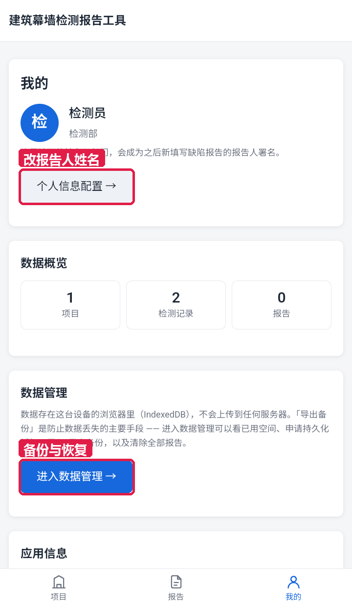
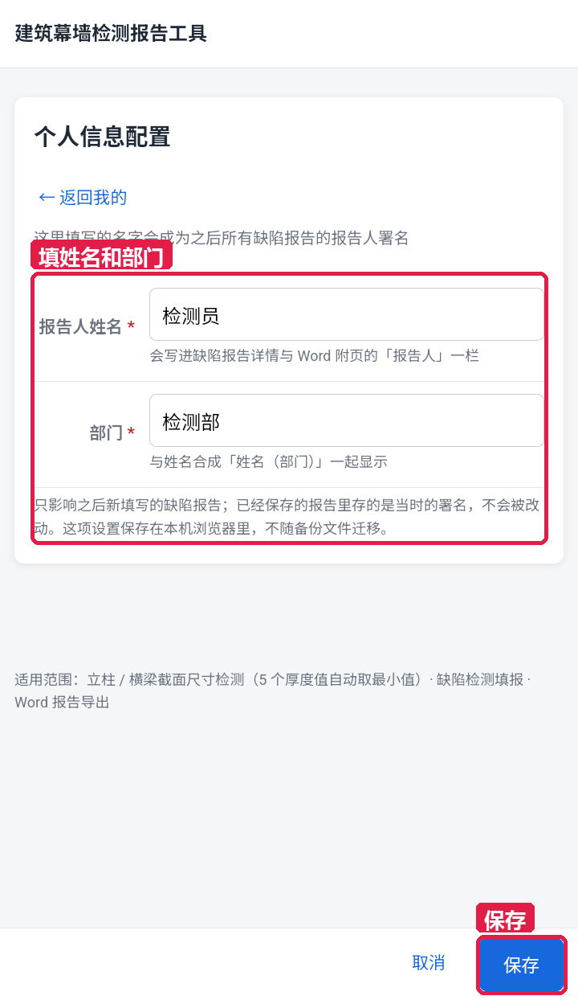
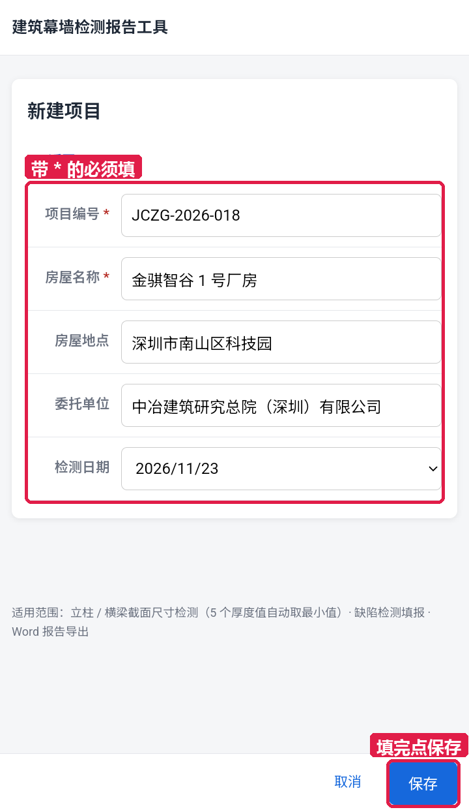
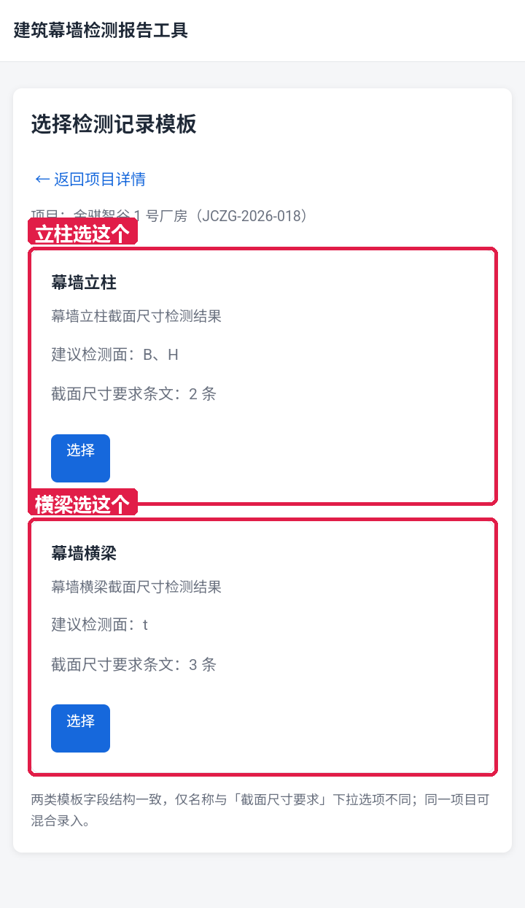
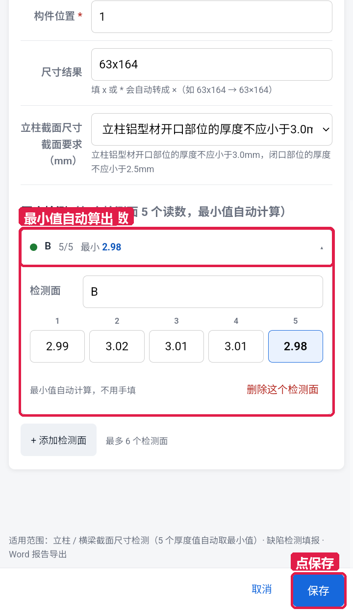
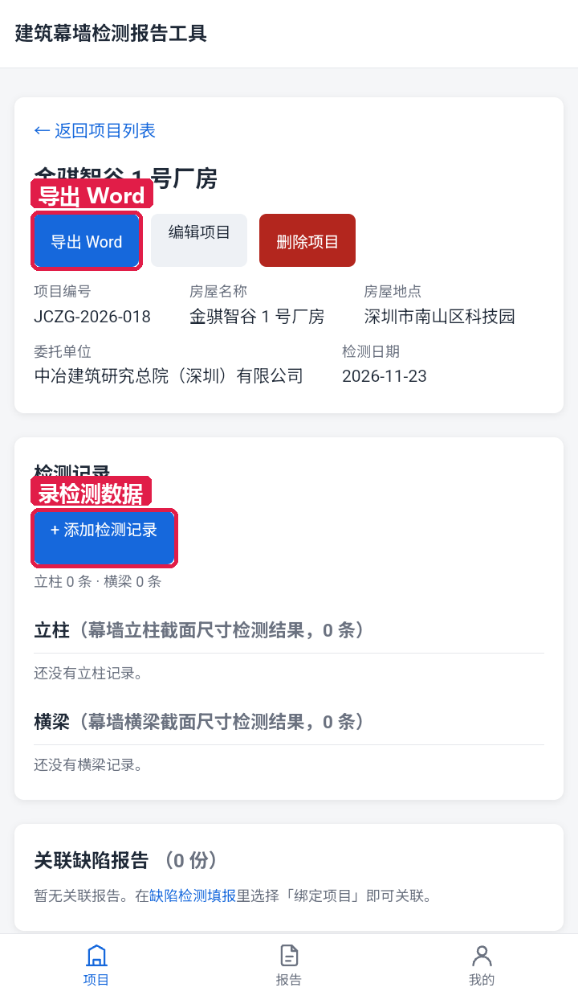
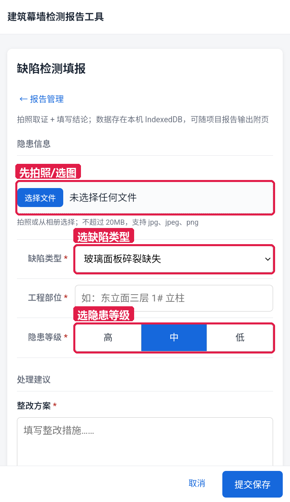
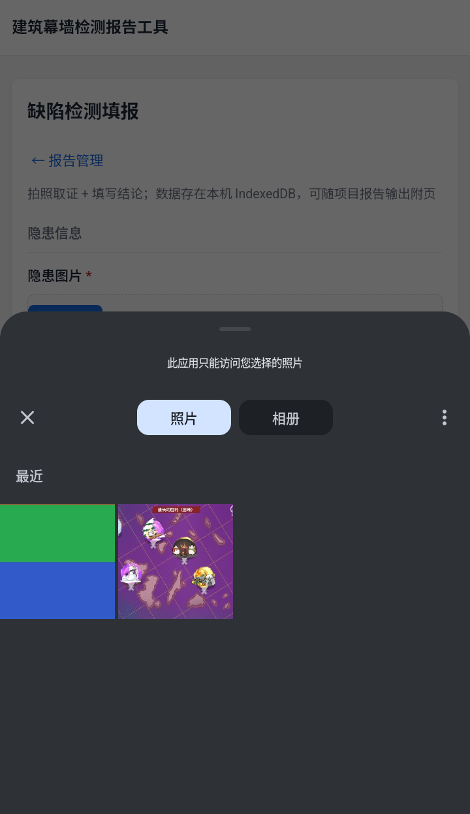
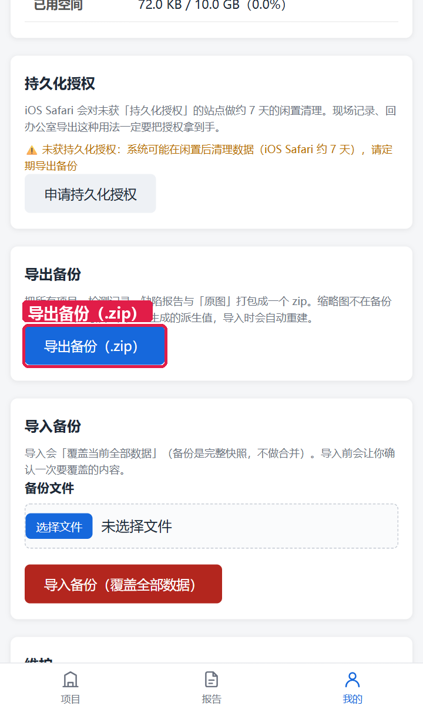
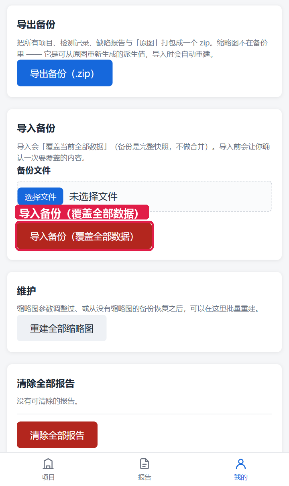

# 建筑幕墙检测报告工具 · 用户操作手册

> **适用版本**：v1.0.3（Android 手机）
> **适用对象**：现场检测工程师 / 检测员
> **配套文档**：《客户部署与使用说明》（部署与网页版）、《交付验收报告》（验收依据）

---

## 0. 一分钟上手

这个 App 帮你把**现场记录**直接变成**Word 检测报告**，全程不用联网：

1. **建项目** → 2. **录立柱/横梁数据** → 3. **拍缺陷照片、填结论** → 4. **导出 Word**

三件必须记住的事：

| 记住 | 为什么 |
| --- | --- |
| 收工时**导出一次备份** | 数据只存在这台手机里，换手机/卸载就没了 |
| 报告人写**自己的名字** | 报告附页的「报告人」取这里，一次设置长期有效 |
| 别在系统设置里**清除数据** | 会把 App 里的项目、记录、照片一起删掉 |

---

## 1. 把软件装到手机上

### 1.1 你会拿到什么文件

安装包文件名类似：**`mcc-inspection-tool-v1.0.3-debug.apk`**，大小约 4.6 MB。

- 如果收到的是**压缩包（.zip）**：先在手机「文件管理」里找到它，**解压**，再从解压出来的文件夹里找 `.apk` 安装。
- 如果收到的是 **`.apk`**：直接点它安装，跳到 1.3。

### 1.2 ※ 最常见的坑：微信传过来变成 `.apk.1`

微信（以及部分 QQ、钉钉）出于安全策略，会把安装包**改名**成：

```
mcc-inspection-tool-v1.0.3-debug.apk.1     ← 装不了！
```

**解决办法（30 秒）**：

1. 打开手机自带的「**文件管理**」（不同品牌叫：文件管理 / 我的文件 / 文件）；
2. 找到「**微信**」或「**下载**」里的这个文件，**长按**它；
3. 选「**重命名**」，把末尾的 **`.1`** 删掉，让它以 **`.apk`** 结尾；
4. 保存后，图标会变成 Android 的安装包样子，点它就能装。

> 小提示：`.apk.2`、`.apk.1(1)` 都是同一类问题，**只保留 `.apk`** 就行。
> 懒得改名的话：让对方用**QQ 的「发送文件」**或用数据线拷进来，一般不会改名。

### 1.3 安装

1. 点安装包，如果提示「**禁止安装未知应用**」，点「设置」→ 允许来自该来源的安装 → 返回继续；
2. 点「**安装**」→ 等几秒 → 点「**打开**」；
3. 桌面上会出现图标「**幕墙检测**」，以后从这里进。

### 1.4 装不上怎么办

| 手机上的提示 | 原因 | 处理 |
| --- | --- | --- |
| 解析包出现问题 | 文件传输不完整（很常见） | 重新拷一次，或用压缩包传输后再解压 |
| 应用未安装 / 安装失败 | 手机空间不足、或被安全软件拦截 | 清理空间；关闭"纯净模式/应用净化"后再装 |
| 已安装相同的应用 / 签名冲突 | 手机上已有旧版，且新旧版本签名不同 | **先「我的 → 数据管理 → 导出备份」**，再卸载旧版，装新版，最后导入备份 |

---

## 2. 第一次打开：先把报告人改成自己

报告里的「报告人」取的是本机设置，**每台手机设置一次**即可。

1. 底部点「**我的**」；
2. 点「**个人信息配置 →**」；
3. 填写「**姓名**」和「**部门**」（部门会跟姓名一起显示成「张三（幕墙检测二部）」）；
4. 点右下角「**保存**」。





> 改了之后**只影响以后新建的缺陷报告**；已经保存的报告保持当时的署名（这是有意的，报告是历史记录）。

---

## 3. 日常流程（四步做完一个项目）

### 第 1 步：新建项目

1. 底部「**项目**」→ 点「**+ 新建项目**」；
2. 填写：

| 字段 | 必填 | 说明 |
| --- | --- | --- |
| 项目编号 | ✅ | 建议用「委托方给的编号」，**不能与已有项目重复** |
| 房屋名称 | ✅ | 会出现在报告标题下方、也会进文件名 |
| 房屋地点 / 委托单位 / 检测日期 | — | 选填，但报告里会体现，建议都填 |

3. 点右下角「**保存**」，进入项目详情页。



### 第 2 步：录立柱 / 横梁检测数据

1. 在项目详情页点「**+ 添加检测记录**」；
2. 选模板：**幕墙立柱**或**幕墙横梁**（两类可以混着录，各录各的）；
3. 填这一条记录：

| 字段 | 必填 | 说明 |
| --- | --- | --- |
| 楼层 | ✅ | 如「六层」「二十三层」 |
| 构件位置 | ✅ | 如「1」「6°」 |
| 尺寸结果 | — | 如 `63x164`、`12+75`；输入 `x` 或 `*` 会自动变成 `×` |
| 立柱/横梁截面尺寸要求 | — | 下拉选规范条文；不选则报告里显示「无」 |
| 检测面 + 5 个厚度读数 | — | **每个面填 5 个数**，最小值自动算出来（不用手填） |

4. 一个构件有多个检测面时，点「**+ 添加检测面**」（最多 6 个面，建议标签：立柱用 B/H，横梁用 t）；
5. 填完点右下角「**保存**」。







### 第 3 步：填缺陷报告（拍照 + 结论）

1. 底部「**报告**」→ 点「**+ 新建报告**」；
2. **先拍照/选图**（必填，单张不超过 20 MB，支持 jpg/png）；
3. 填写内容：

| 字段 | 必填 | 说明 |
| --- | --- | --- |
| 隐患图片 | ✅ | 点「选择文件」→ 拍照 或 从相册选 |
| 缺陷类型 | ✅ | 下拉选择；列表里没有就选「其他（自定义输入）」再自己写 |
| 工程部位 | ✅ | 如「东立面三层 1# 立柱」 |
| 隐患等级 | ✅ | 高 / 中 / 低，**默认「中」** |
| 整改方案 | ✅ | 整改措施写清楚 |
| 相关规范 / 补充建议 | — | 选填；相关规范**每行一条** |
| 绑定项目 | — | 选「项目编号 - 房屋名称」，这份报告就能作为附页跟着项目报告一起导出 |

4. 点右下角「**提交保存**」。
5. 提交后出现在「报告」列表里，可按「高/中/低」筛选、点进去看大图、删除（删除前会二次确认）。





### 第 4 步：导出 Word 报告

1. 回到项目详情页，点「**导出 Word**」；
2. 如果这个项目已经绑定了缺陷报告，会给你两个选择：
   - 「**附加 N 份并导出**」——正文后面把缺陷报告作附页（每份单独一页）；
   - 「**仅导出检测报告**」——只要检测表；
3. 导出完成后：
   - 手机「**文件管理 → 下载 → 幕墙检测**」里能找到这个文件；
   - 如果手机装了 WPS / Office，会同时弹出"打开 / 分享"面板，可以直接发微信；
   - 如果**没装**能打开 Word 的应用，会弹一句「**文件已保存至 下载/幕墙检测/…**」，按这个路径去文件管理里找即可。

文件名格式：**`项目编号_房屋名称_检测报告.docx`**（例：`JCZG-2026-018_金骐智谷 1 号厂房_检测报告.docx`）。

---

## 4. 数据安全：备份与恢复

### 4.1 数据在哪里

所有项目、检测记录、缺陷报告和照片，**只存在这台手机的 App 里**（不会上传到任何服务器）。
所以：**换手机、卸载 App、在系统设置里"清除数据"，都会让数据消失。**

### 4.2 收工时导出一份备份（建议每天一次）

1. 「**我的**」→「**数据管理 →**」；
2. 找到「**导出备份**」，点「**导出备份（.zip）**」；
3. 会生成一个 `幕墙检测备份_日期_时间.zip`，把它**发到微信文件传输助手 / 存网盘 / 拷到电脑**。



> 备份里包含**原图**（缩略图不在里面，导入时会自动重建，所以备份不会特别大）。

### 4.3 换手机 / 重装后恢复

1. 先在新手机上**装好 App**（第 1 章）；
2. 「**我的**」→「**数据管理 →**」→ 找到「**导入备份**」；
3. 点「**选择文件**」，选那个 `.zip` 备份；
4. 系统会弹确认框，写明**当前数据会被覆盖**、备份里有多少项目/记录/报告 —— 看清楚了再点「**导入备份（覆盖全部数据）**」；
5. 导入完成后，项目、记录、报告、照片都回来了。



> ※ 导入是「**覆盖**」不是「合并」。如果新手机上已经录了新数据，**先导出一次备份**再导入。

---

## 5. 常见问题

| 现象 | 原因 | 怎么办 |
| --- | --- | --- |
| 点了「导出 Word」好像没反应 | 已经存好了，只是提示一闪而过 | 去「文件管理 → 下载 → 幕墙检测」看文件；或看屏幕下方有没有 Toast |
| 弹出的分享面板是空的 | 手机里没有能打开 `.docx` 的应用 | 装一个 WPS Office；或直接用上面的路径去文件管理里找 |
| 保存按钮被键盘挡住了 | 旧版本的已知问题 | 升级到 **v1.0.3** 及以上（键盘弹起时保存条会自动抬起） |
| 换手机后打开是空的 | 数据只在本机，没有同步 | 用备份恢复（4.3） |
| 提示空间不足、图片存不下 | 手机存储告急 | 删除旧报告 / 导出并清理后重试 |
| 报告里的"报告人"不是自己 | 还没设置 | 「我的 → 个人信息配置」改一次 |
| 立柱/横梁记录只出现一种 | 只录了一类 | 两类可以混录，缺哪类就补哪类 |

---

## 6. 版本与支持

- **查看版本**：「我的」→「关于本工具 →」，可看到版本号、出品单位、离线缓存版本；
- **适用范围**：立柱 / 横梁截面尺寸检测记录、缺陷检测填报、Word 报告导出（含附页）；
- **不在本工具范围**：膜厚检测、玻璃面板检测、速记、统计报表、登录与权限；
- **技术支持**：请联系项目交付方（联系方式由委托单位填写）。

---

### 附：本手册的截图说明

文中截图取自 **v1.0.3** 的真实界面（Android 手机，720×1280 竖屏），
为便于阅读已裁掉手机状态栏；红框是后加的，用来指出你该点的位置。
